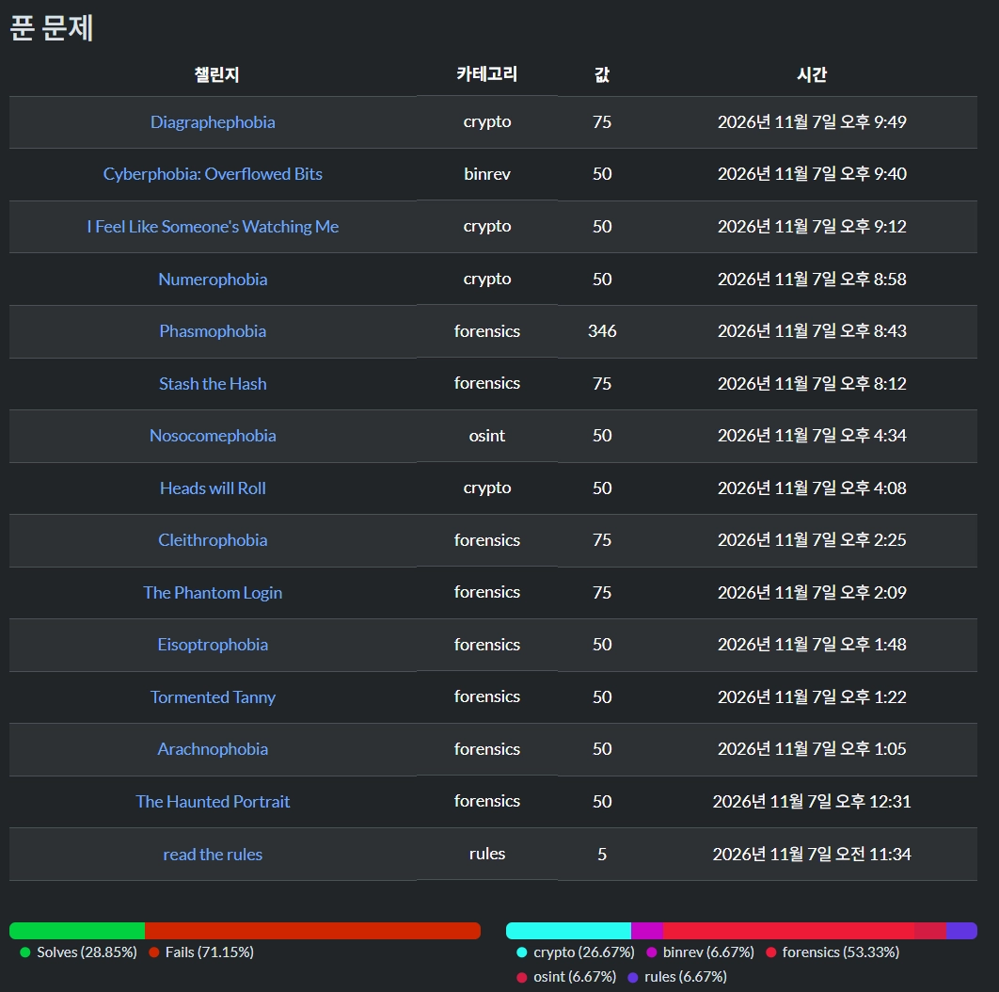

오랜만에 CTF를 참여했다. 
최근들어 해킹 공부를 소홀이 했어서 감도 잡고 재시작도 해볼 겸 참여하려고 한 거였으나.. 
포너블 문제는 거의 존재하지 않았고, 거의 다뤄보지 않았던 포렌식이랑 암호학 문제가 많았다. 
근데 막상 해보니까 포너블과 다른 매력으로 플래그를 찾아내는 매력이 있어서 조금 빠져들게 되었다. 

## SpookyCTF 2026
<https://ctftime.org/event/3339>  
뉴저지 공대에서 주최한 CTF라고 한다. 
매년 연례 행사처럼 할로윈 컨셉으로 개최하는 대회다. 
난이도는 그다지 어렵지 않으며, 새로운 툴들을 써보고 많은 유형을 접해야 하는 나같은 뉴비에게 딱 알맞은 CTF라고 생각한다. 
 

`flag 형식 == 'spooky{}'`

# Forencisc
## The Haunted Portrait (50)
>An old portrait was recently discovered in a storage room at NJIT just before Halloween. Students claim the painting changes when viewed at night, and some believe a secret message is hidden inside it. The university's security team examined the image but couldn't find anything unusual. Can you uncover what the portrait has been hiding all these years?
{: .prompt-info }
첨부파일
: png파일 1개

<https://georgeom.net/StegOnline/image> 를 이용해서 스테가노그래피를 찾아주면 된다.
>스테가노그래피(Steganography)는 그리스어 '스테가노스(steganos: 덮여진)'와 '그라피아(graphia: 통신하다)'의 합성어로, 데이터가 존재한다는 사실 자체를 숨기는 데이터 은닉 기술입니다.
{: .prompt-tip}

{:.w-50 .left}
이번 문제에서는 Blue 채널의 LSB를 변조한 방식이다.  
사진 파일은 각 픽셀별로 왼쪽처럼 RGB 값이 존재한다. 그리고 가장 작은 비트인 LSB는 변하게 되어도 인간의 눈으로는 큰 차이를 느끼지 못한다. RGB 채널의 LSB를 변조해서 원하는 값을 집어 넣는 방식이 사진에 데이터를 넣는 기본적인 은닉 방식이다.   
{:.w-50 .left}
Blue 채널의 LSB에 이런 사진이 숨겨져 있었다.   그러나 flag 형식이 우리가 원하는 형태가 아니다. 3번째 4번째 알파벳이 같은 것을 보아 mono alphabetic substitution임을 추측할 수 있다. 카이사르 암호 브루트포스 사이트를 이용해서 해결하면 다음과 같이 플래그를 얻을 수 있다.      

|Shift      |decrypt                            |
|:----------|:--------------------------------  |
|13         |spooky{portraits_keep_secrets}  |

                        
