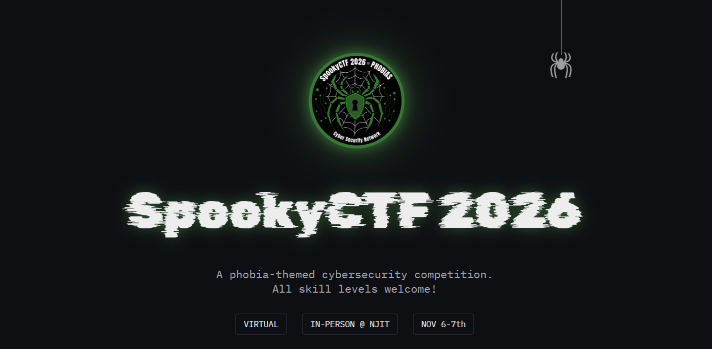

오랜만에 CTF를 참여했다.<br>
최근들어 해킹 공부를 소홀이 했어서 감도 잡고 재시작도 해볼 겸 참여하려고 한 거였으나..<br>
포너블 문제는 거의 존재하지 않았고, 거의 다뤄보지 않았던 포렌식이랑 암호학 문제가 많았다.<br>
근데 막상 해보니까 포너블과 다른 매력으로 플래그를 찾아내는 매력이 있어서 조금 빠져들게 되었다.<br>
이번 글에서는 포렌식과 크립토 문제 write-up을 작성하려고 한다.


## SpookyCTF 2026
<https://ctftime.org/event/3339> <br>
뉴저지 공대에서 주최한 CTF라고 한다.<br>
매년 연례 행사처럼 할로윈 컨셉으로 개최하는 대회다.<br>
난이도는 그다지 어렵지 않으며, 새로운 툴들을 써보고 많은 유형을 접해야 하는 나같은 뉴비에게 딱 알맞은 CTF라고 생각한다.

`flag 형식 == 'spooky{}'`

# Forencisc
## The Haunted Portrait (50)
>An old portrait was recently discovered in a storage room at NJIT just before Halloween. Students claim the painting changes when viewed at night, and some believe a secret message is hidden inside it. The university's security team examined the image but couldn't find anything unusual. Can you uncover what the portrait has been hiding all these years?
{: .prompt-info }
첨부파일
: png 파일 1개


<https://georgeom.net/StegOnline/image> 를 이용해서 스테가노그래피를 찾아주면 된다.
>스테가노그래피(Steganography)는 그리스어 '스테가노스(steganos: 덮여진)'와 '그라피아(graphia: 통신하다)'의 합성어로, 데이터가 존재한다는 사실 자체를 숨기는 데이터 은닉 기술입니다.
{: .prompt-tip}

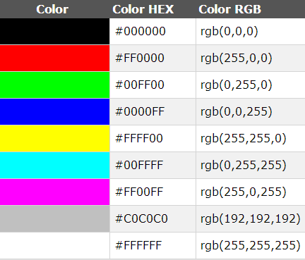{:.w-50 .left}
이번 문제에서는 Blue 채널의 LSB를 변조한 방식이다. <br>
사진 파일은 각 픽셀별로 왼쪽처럼 RGB 값이 존재한다. 그리고 가장 작은 비트인 LSB는 변하게 되어도 인간의 눈으로는 큰 차이를 느끼지 못한다. RGB 채널의 LSB를 변조해서 원하는 값을 집어 넣는 방식이 사진에 데이터를 넣는 기본적인 은닉 방식이다.<br><br><br>
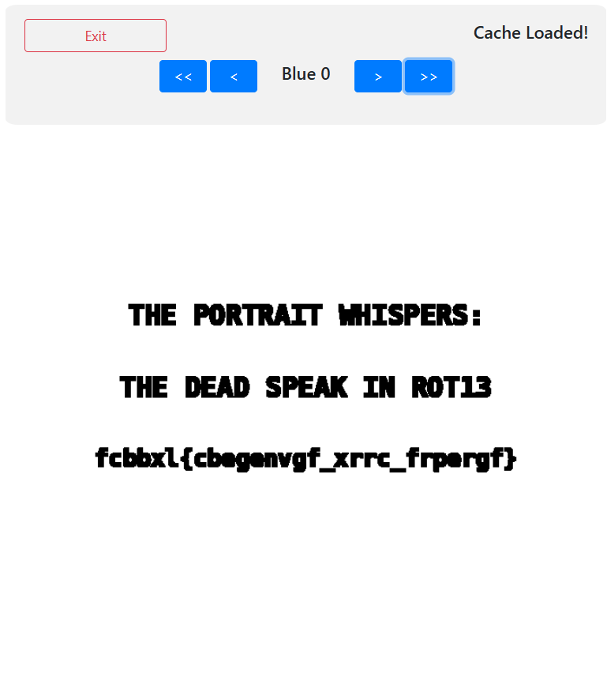{:.w-50 .left}
Blue 채널의 LSB에 이런 사진이 숨겨져 있었다. <br> 그러나 flag 형식이 우리가 원하는 형태가 아니다. 3번째 4번째 알파벳이 같은 것을 보아 mono alphabetic substitution임을 추측할 수 있다. 카이사르 암호 브루트포스 사이트를 이용해서 해결하면 다음과 같이 플래그를 얻을 수 있다.<br><br><br><br><br><br>

|Shift      |decrypt                            |
|:----------|:--------------------------------  |
|13         |spooky{portraits_keep_secrets}  |

<br>
## Arachnophobia (50)
>Something about the SpookyCTF logo feels off… like something’s tangled in the webs
{:.prompt-info}
첨부파일
: png 파일 1 개
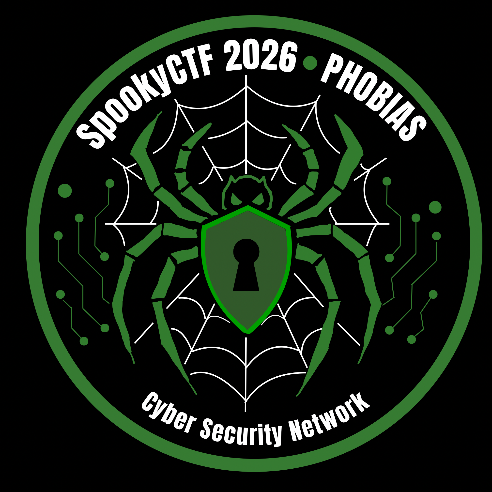


1. steg online에 업로드 시도, 실패 (용량 또는 포맷 문제로 추정)

2. binwalk로 zip파일이 붙어 있음을 확인
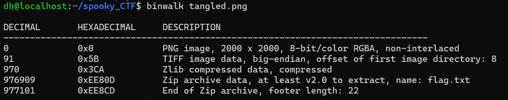
-e 옵션을 이용해서 추출해준다
flag.txt를 읽어준다.

<br>
## Tormented Tanny (50)
>An image was captured of a vicious beast while guarding his castle. The cameraman may have found just what makes this beast so furious. Unfortunately, the cameraman seems to have gone missing. Maybe the photo contains the answer.
{:.prompt-info}
첨부파일
: png 파일 1 개


1. steg online에 업로드 시도, 별다른 게 확인되지 않음
2. binwalk로도 별다른 특징 x
3. strings 명령어로 문자열을 확인

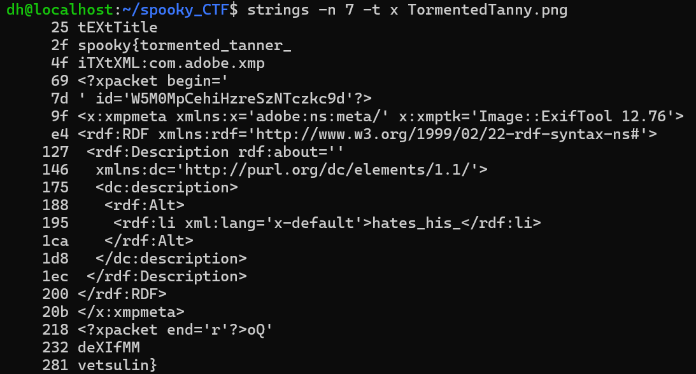

`281 vetsulin}` 확인 후 flag가 숨겨져 있을 것임을 추측

`spooky{tormented_tanner_` + `hates_his` + `vetsulin}` 플래그 획득

<br>
## Eisoptrophobia (50)
>Something strange is happening in the mirror. What appears to be an ordinary reflection may be hiding something more than meets the eye. Look closely, investigate the image, and uncover what lies beneath the surface.
{:.prompt-info}
첨부파일
: png 파일 1 개

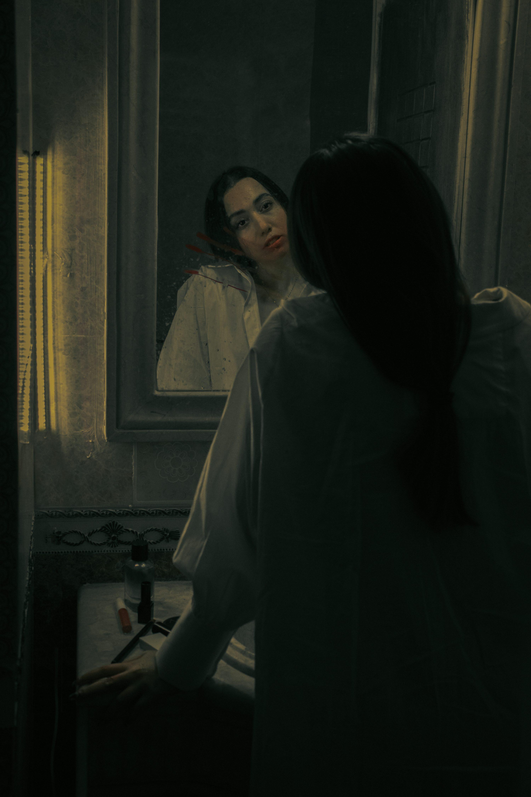

1. 위의 과정들을 해봤으나 실패
2. 거울과 관련될 것이라고 추측 후 convert -flop 옵션으로 좌우반전을 해봤으나 실패
3. 각 픽셀 rgp 마지막 비트를 뽑아서 한 줄로 붙임

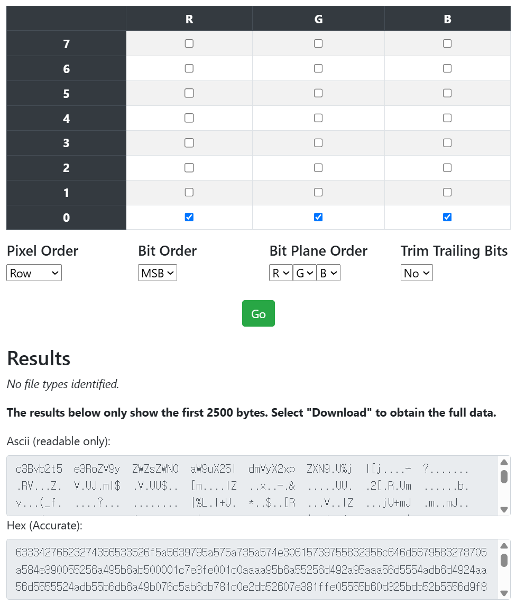
읽을 수 있는 문자 발견 `c3Bvb2t5  e3RoZV9y  ZWZsZWN0  aW9uX25l  dmVyX2xp  ZXN ...`<br>
cyberchef를 이용해서 base64기반으로 복호화
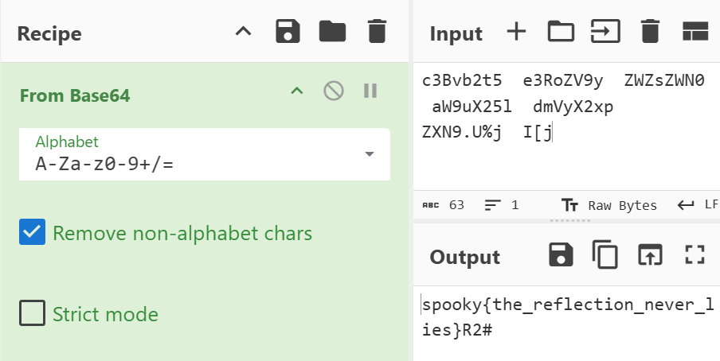

>참고 : zsteg -a [file] => 할 수 있는 거 다 뽑아준다
{:.prompt-tip}

<br>
## The Phantom Login (75)
>It's Halloween night at NJIT, and something strange has been happening on the network.<br><br>At 3:13 AM, the university's security team detected unusual authentication activity involving an account that should have been forgotten long ago. The SOC recovered Windows security logs and web access records, but the evidence is buried among hundreds of seemingly normal events. Your task is to investigate the suspicious activity, determine what happened, and uncover the secret left behind. The ghosts of NJIT don't give up their secrets easily.
{:.prompt-info}
첨부파일
: txt 파일 1 개, md 파일 1 개, csv 파일 1 개, log 파일 1 개

scv 파일과 log 파일을 시간 순서로 정렬했다
: csv의 경우 excel로 정렬<br>log 파일의 경우 $sort njit_web.log > sorted.log 로 파일 생성

**사건 재구성**<br>

| 시각 (UTC) | 출처 | 내용 |
| :---: | :---: | --- |
| 01:48 ~ 01:54 | CSV | `198.51.100.66`이 `administrator` 계정으로 14번 로그인 실패 (미끼, 성공 없음) |
| 03:10 ~ 03:12 | CSV | `203.0.113.77`이 `evelyn.graves` 계정으로 9번 로그인 실패 (비밀번호 오류) |
| 03:14 | CSV | 같은 IP로 **로그인 성공** (`LogonID=0xB130`) |
| 03:15 | CSV | 특수 권한 부여 |
| 03:16 | 웹 로그 | `/archives/` 접근 |
| 03:17 | CSV | `\\BW-FS01\Archives$` 공유 폴더 접근 |
| 03:18 | 웹 로그 | `/archives/records?year=1893` 조회 |
| 03:19 | 웹 로그 | `/archives/export?note=<Base64>` 요청, **플래그 획득** |

<br>
## Cleithrophobia (75)
>You are stuck inside of the Enterprise with no way out. The rest of the crew has gone missing. They need help finding a way back to a Federation outpost but the ship is stuck dead in space. Maybe the packet file they have can find a way to start the ship.
{:.prompt-info}
첨부파일
: pcap 파일 1 개

wireshark를 이용해서 패킷 캡쳐 파일을 열음

문자 검색으로 spooky, Spooky, c3Bvb2t5, flag, secret, key를 검색 → 안 나옴

Porotocaol Hierearchy Statistics 기능을 이용해서 각 프로토콜에서 몇 개의 통신이 오갔는지 확인

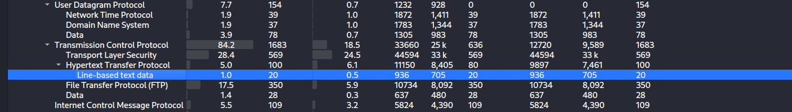

**패킷 분석 필터**

| 필터 | 볼 것 |
| --- | --- |
| `http` | 요청 경로, `Authorization` 헤더, 응답 헤더와 본문 |
| `http.request.method == "POST"` | 전송된 폼 데이터, 로그인 정보, 업로드 |
| `ftp or telnet or pop or imap or smtp` | 평문 로그인, 명령어, 메일 내용 |
| `dns` | 유난히 긴 도메인이나 Base64처럼 생긴 서브도메인 |
| `icmp` | 데이터 부분(payload)에 숨은 내용 |
| `tls` | 암호화됨. 문제에서 키 파일을 줬는지 확인 |
| `usb` / `bluetooth` | 키보드 입력, 파일 전송 |

http.response에서 응답코드가 200인 것 중 plain text를 발견

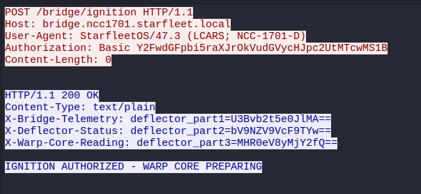

base64로 복호화해서 flag 획득


<br>
## Stash the Hash (75)
>A file was found that seems to contain detailed information about an infamous and high-profile cryptid. There account is known to contain forbidden supernatural information. If you can find out what their password is you may be able to obtain this information for yourself
{:.prompt-info}
첨부파일
: 7z 압축 파일 1 개, txt 파일 1 개

7z 압축 파일은 비밀번호로 잠겨 있음

txt 파일 내용
```
Username: dleeds
Password: ad7bcd7ab3cc113f496e1840bc582bbd
Full Name: Daniel Leeds
Display Name: DevilLeeds
Email: dleeds@galloway.com
Department: Horror Management
Employee ID: NJ-062805
Account Created: 2022-06-08
Last Login: 2026-10-31 18:06:06
Account Status: Active
```
비밀번호가 md5 형식으로 잠겨 있음
md5 해싱 크랙
```sh
$ echo "ad7bcd7ab3cc113f496e1840bc582bbd" > hash.txt
$ hashcat -m 0 -a 0 hash.txt /usr/share/wordlists/rockyou.txt
$ hashcat -m 0 hash.txt --show
ad7bcd7ab3cc113f496e1840bc582bbd:newjerseydevils
```
newjerseydevils로 7z 압축을 해제
: png 파일 1개가 나옴
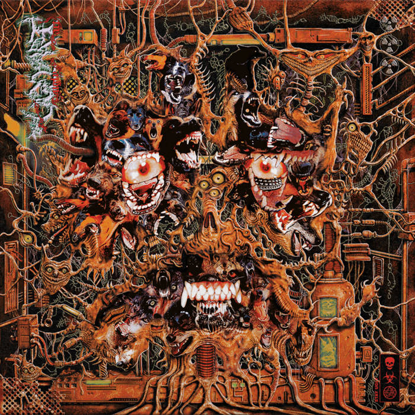

스테가노그래피 툴을 이용해 red의 LSB를 읽어내면 다음과 같이 나오게 된다
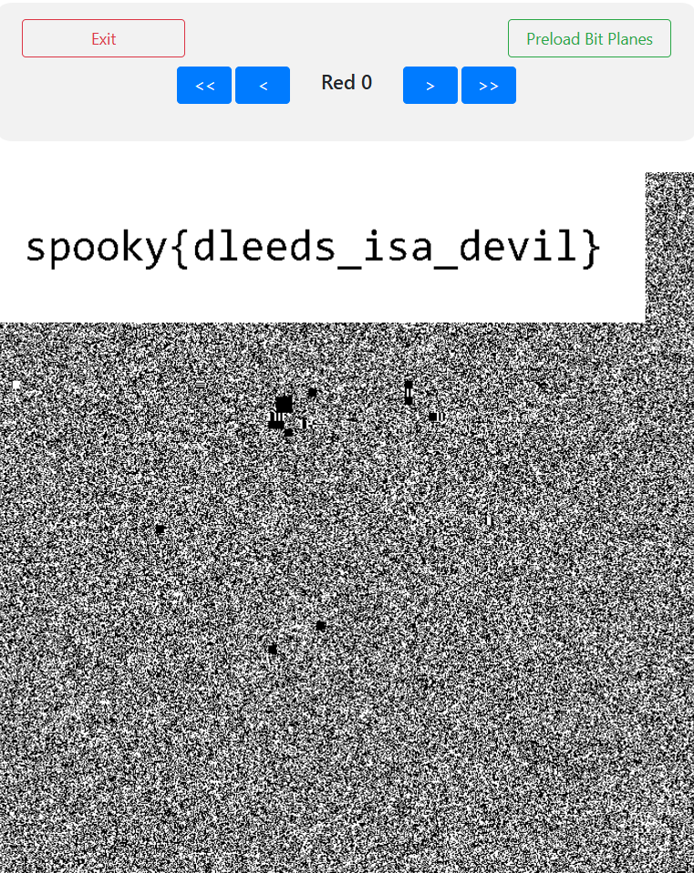

<br>
## Phasmophobia (331)
>Whenever I see Eberhardt Hall...I get quite the heebie jeebies<br><br>
Especially as Halloween draws near. That place just...feels like a haunted mansion. Matter of fact; I'm pretty sure it is! I went in recently, and some eerie, haunted house like music started playing. That caught me off guard; especially as I was pretty sure I heard someone...or something whispering. To make matters even worse...at the same time I think I even saw a portrait shift. It was pretty strange. Maybe. I wasn't sure. I was losing it; especially when I was certain I saw a ghost wearing a laurel from the corner of my eye." "BUT I did not think about it for even a moment. I scram skedaddled out of there. NOPE!" "Although...now that I think about it...I wonder what those whispers I heard were...
{:.prompt-info}
첨부파일
: wav 파일 1 개, jpg 파일 1 개
wav 파일은 audacity로 열어서 스펙트로그램으로 변환해주었음
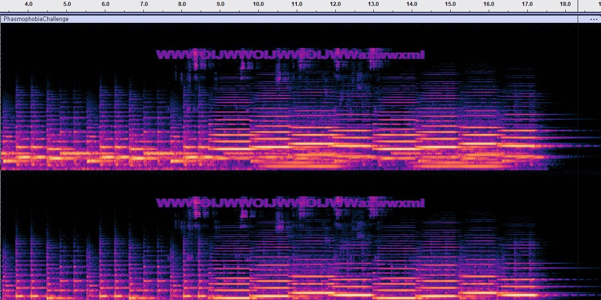

`WWWOIJWWOIJWWOIJWWaxwwxml` 을 추출할 수 있었음

사진 파일의 경우 LSB를 추출하면 `..."JWWo  wbgwc (2  ) (18 sa  lads. yu  mmers).V  .RU` 가 나옴

salad 는 카이사르 암호를 나타내는 힌트로 자주 쓰인다.
18shift 카이사르를 각각 해주었다

`OOOGABOOGABOOGABOOspooped` + `BOOgotyou` 를 얻을 수 있게 되었다.

<br>
# Crypto
## Heads will Roll (50)
>While chasing Ichabod Crane through Sleepy Hollow, the Headless Horseman got as close as he could, then threw his head! While rolling, rolling, rolling, rolling, through the air, his pumpkin head shouted…what? His perfect aim knocked Ichabod to the ground near the rails, but what did he say?
{:.prompt-info}
첨부파일
: txt 파일 1 개
Etu_taip5_w5n_hpmnw_hlgsdso{lyh0_d}jyi_piihef_ne_oy3p0lh4oskt_i:k3l3

{}가 있는 것을 보아 잘 shift하거나 잘 섞으면 flag가 나타날 것 같다.<br>
지문을 잘 읽어보면 다음과 같은 힌트를 얻을 수 있다.<br>
1. “near the rails”: 레일 펜스(rail fence)를 직접 가리키는 말
2. “rolling, rolling, rolling, rolling”: 4번 반복됨. 레일 개수(키)가 4라는 뜻
3. “threw his head”: 이 문제는 CTF의 flag 형식으로 답하는 문제라는 뜻

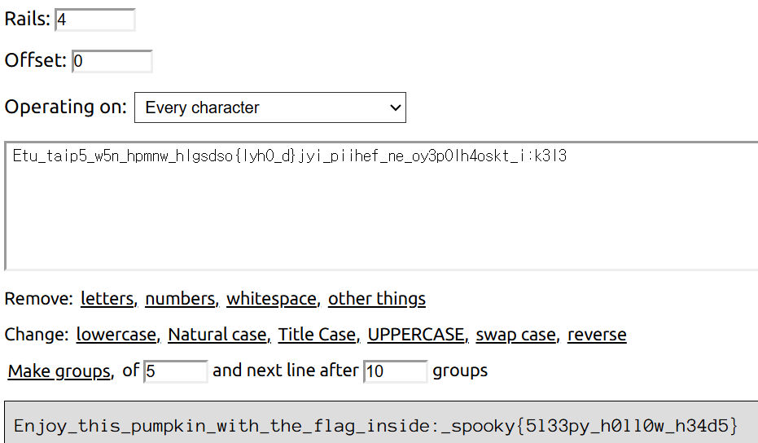

<br>
## Numerophobia (50) //나잖아?
>I went exploring the house of the crazy old man on the corner of the street. He disappeared last weekend and nobody has seen him since. Rumor has it that he was last seen walking out at midnight screaming random numbers in tongues never spoken before. I decided to go and investigate, unsurprisingly the front door was left unlocked. On the way to the stairs I almost tripped over a stack of books, one was about dyslexia I think. For some reason every other step was missing and marked with a 13 on the wall. I finally reached the top and headed towards the light at the end of the hallway. Taped on the wall was a piece of paper…
{:.prompt-info}
첨부파일
: txt 파일 1 개
```
23 50 65 50 65 50 65 50 65 50 65 50 65 50 65 50 65 50 65 50 65 50 65 50 65 50 65 50 65 50 65 50 65 50 65 50 65 50 65 10 138 50 65 95 123 51 64 98 108 53 134 52 132 108 65 95 66 52 117 95 127 51 132 53 123 52 108 51 117 116 136 121 120 111 124 112 128 10 63 52 63 52 63 52 63 52 63 52 63 52 63 52 63 52 63 52 63 52 63 52 63 52 63 52 63 52 63 52 63 52 63 52 63 52 63 52
```
또한 지문에 힌트가 존재한다
1. “random numbers” → 숫자는 10진수 ASCII 코드
2. “every other step was missing and marked with a 13” → 한 칸 걸러 13을 뺀다
3. “a book about dyslexia” → 문자열이 뒤집혀 있다

가운데 10을 경계로 138부터 아스키로 변환하면 다음과 같이 나온다.<br>
`Š2A_{3@bl5†4„lA_B4u_3„5{4l3utˆyxo|p€`<br>
번갈아가며 13을 빼준 뒤 아스키로 변환하면 다음과 같이 나온다.<br>
`}24_n33b_5y4wl4_54h_r3w5n4_3ht{ykoops`<br>
이걸 뒤집으면 `spooky{th3_4n5w3r_h45_4lw4y5_b33n_42}`가 된다.<br>

<br>
## I Feel Like Someone's Watching Me (50)
>A letter is found beside a tombstone in a graveyard, but it seems to have been scrambled around.
{:.prompt-info}
첨부파일
: txt 파일 1 개

```
Ypejpof Erpveaypj,

... (생략)

D clqp zlw tday hp iptljp fcpz yl.

Odagpjprz,

Fcp Lap Zlw Rptf Ipcday
```

어떻게 봐도 알파벳을 바꾼 영어 문장으로만 보인다.<br>
Mono-alphabetic Substitution 암호는 통계적인 도구(bigram, trigram)를 이용해서 해결할 수 있다.<br>
dCode monoalphabetic substitution에서 자동으로 풀어주기도 한다.

마지막 부분
```
BUT I'LL PUT A CLUE THAT SHOULD HELP YOU FIND ME IF YOU STILL CARE. EYEZ ARE WATCHING ME. JUST REMEMBER UNDERSCORES INSTEAD OF SPACES AND TO WRAP IT CORRECTLY. I HOPE YOU FIND ME BEFORE THEY DO. SINCERELY, THE ONE YOU LEFT BEHIND
```
편지의 내용대로 EYEZ ARE WATCHING ME 잘 감싸서 아래 언더바를 넣어주면 된다

<br>
## Diagraphephobia (75)
>The Federation has found a redacted file from spying on the Klingon. They want to know the contents of it. Can you find it?
{:.prompt-info}
첨부파일
: pdf 파일 1 개
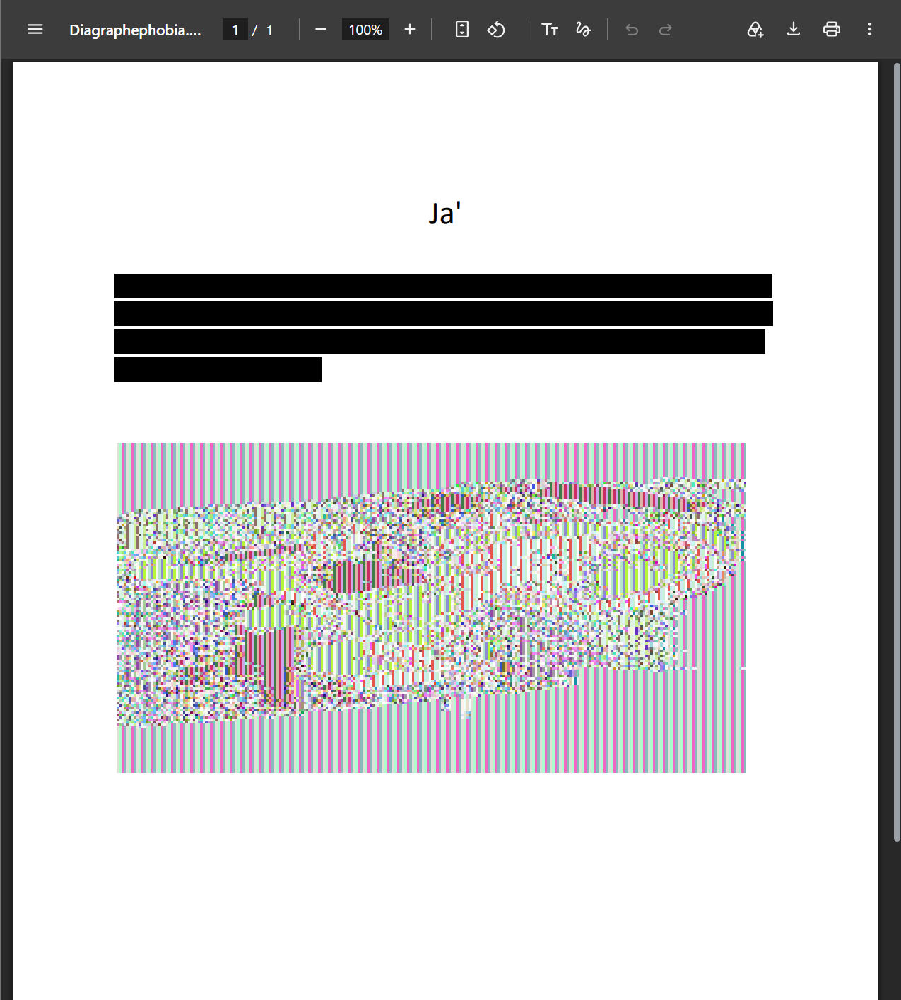

페이지 본문에는 Ja' 라는 제목과 base64 문자열이 있다.<br>
메타데이터의 Subject 필드에 `lojmIt yIpoSmoH!`가 있다.<br>
둘 다 킬링온어라고 한다.<br>

base64 문자열을 디코딩하여도 의미 있는 문장이 나오지 않는다. base64를 디코딩한 문자열이 암호문이 된다는 증거다.<br>
base64 문자열을 디코딩한 문자열이 160 바이트이므로 16바이트 블록 암호로 복호화하는 것이 유력하다. <br>
또한 pdf 파일의 이미지를 보면 줄무늬와 윤곽이 있는데, 이는 블록 암호를 ECB 모드로 쓴 흔저기다. ECB 모드는 모든 블록을 같은 키로 암복호화 하는 방식이다.<br>

메타데이터의 Subject 문자열이 16바이트기 때문에 AES-128 키와 정확히 일치한다.<br>
AES-128 ECB 방식으로 복호화를 해주면 다음과 같이 결과를 얻을 수 있다.
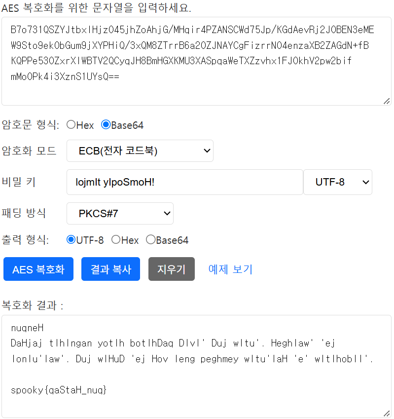

# 후기
포렌식의 경우 창의적인 문제가 많이 나와서 문제 하나하나가 다 재밌었다. <br>
와이어샤크의 경우 한번 써보고 싶은 욕구가 있었는데 이번 기회에 사용해볼 수 있어서 좋은 경험이라고 생각한다.<br>
그리고 적당한 암호학 지식이 지속적으로 요구돼서 경험과 지식이 꽤나 쌓여야 더 높은 난이도의 문제를 풀 수 있을 것 같다.<br><br>
암호학의 경우 선지가 큰 힌트가 되는 게 너무 열받았다.<br>
전부 영어로 나오니까 접근 포인트가 바로 떠오르거나 직관적으로 느껴지지가 않았다...<br><br>
오랜만에 ctf 참여는 좋은 자극이 되었던 것 같다.<br>
꾸준히 참여하고, 후기를 올려보도록 해야겠다...